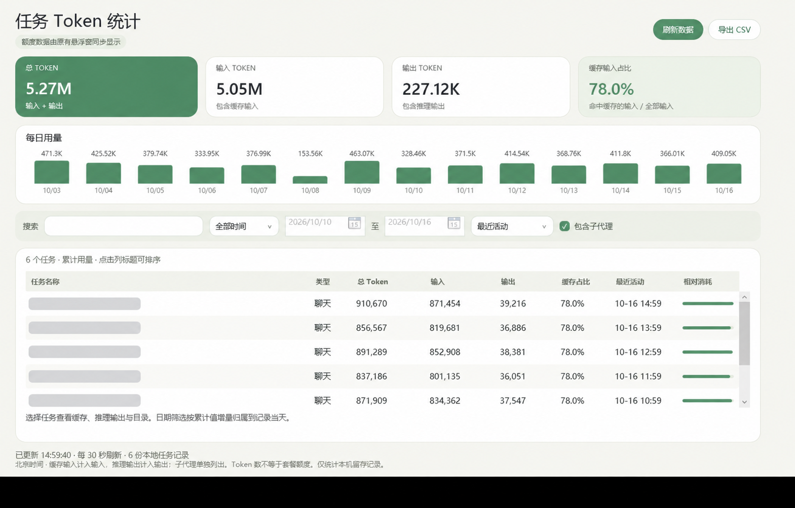

# Codex Usage Viewer

一个 Windows 桌面小工具：用悬浮窗查看 Codex 套餐剩余额度，用统计面板查看每个任务消耗的 Token。

使用 C#、WPF 和 .NET Framework 4.8 开发。额度通过本机 Codex App Server 读取，任务统计来自本机已有的会话记录，无需在本工具中填写 API Key。




*截图使用模拟用量，任务名称已打码，不包含真实聊天记录。*

## 功能

- **额度悬浮窗**：显示五小时、每周窗口的剩余额度、重置时间和数据状态。
- **桌面与托盘操作**：支持拖动、折叠到屏幕边缘、始终置顶、全屏时自动隐藏，以及托盘菜单。
- **任务 Token 统计**：查看总量、输入、输出、缓存输入占比和每日趋势。
- **最近任务优先**：默认按最近活动排序，也可切换为消耗排行或点击表头排序。
- **筛选与明细**：按任务名称、目录或 ID 搜索，支持今天、近 7 天、近 30 天及自定义日期范围。
- **子代理记录**：单独展示子代理用量，可选择是否计入汇总。
- **CSV 导出**：导出当前筛选结果，便于进一步分析。
- **统一外观**：柔和绿色、暖白底色、圆角卡片，与额度悬浮窗保持一致。

额度悬浮窗支持简体中文、英文及跟随系统；任务统计面板目前使用简体中文。

## 运行环境

- Windows 10 / 11，x64。
- .NET Framework 4.8。
- 已安装 Codex，且本机已完成登录。额度查询需要可用的 `codex app-server`。
- 任务统计需要本机保留相应会话文件；没有额度数据时，仍可独立查看本地任务统计。

本项目是社区工具，与 OpenAI 官方产品没有隶属关系。

## 使用

运行自行编译的程序，或从仓库的 Releases 页面下载已发布的 Windows 版本。

1. 启动 `CodexUsageViewer.exe`，查看桌面额度悬浮窗。
2. 右键悬浮窗或系统托盘图标，选择 **任务 Token 统计**。
3. 在统计窗口中切换日期、搜索任务，或选择任务查看明细。
4. 关闭统计窗口后，悬浮窗与托盘继续运行；彻底退出请使用右键菜单中的“退出”。

双击悬浮窗可折叠到屏幕边缘，单击圆点可恢复。额度默认每 60 秒刷新，本地任务统计窗口每 30 秒刷新，也可手动刷新。

首次启动时可直接打开统计页：

```powershell
.\CodexUsageViewer.exe --tasks
```

`--tasks` 在新进程首次启动时生效；程序已运行时，重复启动会唤起已有悬浮窗。

## 从源码构建

在仓库根目录运行：

```powershell
powershell -NoProfile -ExecutionPolicy Bypass -File .\build.ps1
```

生成文件：`build/CodexUsageViewer.exe`。

构建脚本使用系统 .NET Framework 程序集，首次运行会从 NuGet 下载固定版本的 Roslyn 4.8 编译器并校验 SHA256。编译器和构建结果保存在 `build/`，不提交到仓库。此方式无需 Python 或 .NET SDK；首次构建需要网络连接和 PowerShell 5.1 或更高版本。

也可指定输出目录：

```powershell
powershell -NoProfile -ExecutionPolicy Bypass -File .\build.ps1 -OutputDirectory D:\Build\CodexUsageViewer
```

项目文件位于 `src/CodexUsageViewer/CodexUsageViewer.csproj`，有相应 .NET SDK 和 .NET Framework 4.8 引用程序集的开发环境也可使用项目文件构建。

## 运行测试

```powershell
powershell -NoProfile -ExecutionPolicy Bypass -File .\test.ps1
```

统计测试只创建并读取模拟会话，覆盖累计快照去重、归档去重、缓存和推理子项、北京时间跨日增量、日期筛选、缓存更新及不完整记录等情况；不会读取开发者的真实聊天数据，也不会查询额度。

## 数据来源与隐私

| 功能 | 数据来源 |
| --- | --- |
| 套餐剩余额度 | 本机官方 Codex App Server 的 `account/rateLimits/read` |
| 任务标题 | `session_index.jsonl` |
| 任务用量 | `sessions/`、`archived_sessions/` 中的 `token_count` 累计记录 |
| 窗口位置、语言及额度缓存 | `%LOCALAPPDATA%/CodexUsageViewer/` |

任务记录默认从用户目录下的 `.codex` 读取，也支持 `CODEX_HOME` 环境变量。找不到 `session_index.jsonl` 中的标题时，会以未命名任务和 ID 显示。

应用没有新增 HTTP 上传、第三方分析或远程日志功能。额度查询由独立的官方 Codex 进程处理，其认证和网络行为属于官方客户端；本工具不直接读取 `auth.json`、API Key、访问令牌或浏览器 Cookie。

任务统计只在内存中缓存。应用会在本地保存显示设置、额度缓存、诊断日志和数据访问说明；CSV 仅在用户选择保存位置后导出，包含当前任务标题、目录、ID 和用量。分享 CSV 或截图前，请自行检查其中的任务信息。

## 统计口径

- **总 Token = 输入 + 输出**。缓存输入属于输入的子项，推理输出属于输出的子项，不能再额外相加。
- 每个线程采用最高的累计快照，同一快照不会反复累加；当前与归档目录中的同一线程 ID 会去重。
- 默认显示并汇总子代理，但子代理单独成行；父任务行只表示该线程自身的用量。
- 缺少用量记录显示 `—`，表示未知，不代表零消耗。
- 日期筛选使用累计值的正增量，按记录事件的**北京时间**归属。首个可用快照的累计值归到该记录当天；记录不完整时，日期分布可能不完整。
- 每日图默认显示最近 14 天；较长的筛选范围会合并为最多 14 个连续区间。表格的“最近活动”来自任务文件最后修改时间。
- 如果累计值发生回退，保留最高值并在界面提示。仅凭异常的本地记录，无法可靠还原回退后的新增消耗。

**Token 数不等于套餐额度，也不代表最终账单。** 被删除、未同步到本机或未记录用量的历史任务无法由本工具恢复。Codex 的本地文件格式和 App Server 接口变化也可能影响兼容性。

## 项目结构

```text
.
├── README.md
├── LICENSE
├── build.ps1                       # 编译程序
├── test.ps1                        # 运行模拟数据测试
├── src/CodexUsageViewer/
│   ├── CodexUsageViewer.csproj
│   ├── CodexUsageViewer/           # 悬浮窗、托盘、统计 UI 与数据读取
│   ├── CodexUsageViewer.Usage/     # 额度查询、缓存与数据模型
│   ├── Properties/
│   ├── app.ico
│   └── CodexUsageViewer.Resources.Strings.*.txt
├── tests/                          # 统计测试
└── docs/                           # 模拟数据截图与发布说明
```

## 反馈与贡献

欢迎提交 Issue 和 Pull Request。反馈问题时请提供 Windows 版本、Codex 版本、复现步骤和必要的脱敏日志，不要提交认证文件或完整的私人会话记录。

当前维护源码由既有桌面程序恢复后整理，并继续迭代；部分原有代码仍保留恢复后的命名风格。欢迎提交可读性改进和兼容性修复。

## 许可证

采用 [MIT License](LICENSE)。
